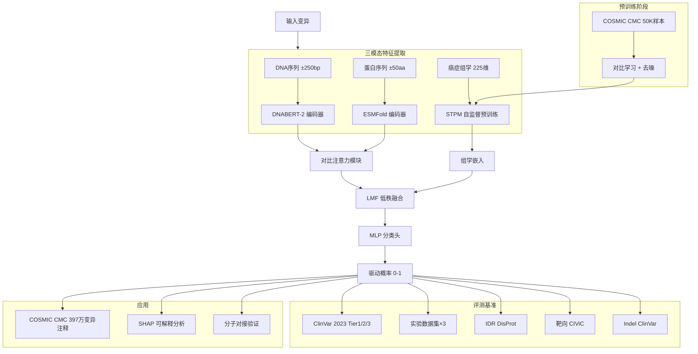

## 01 基本信息

- **标题**：A multimodal framework for comprehensive driver variant prediction in cancer
- **作者**：Yang, Hai; Chen, Yijia; Zhou, Tianyi; Wang, Yingzhao; Zhou, Qin; Xiao, Ting; Zhang, Qian; Zhang, Jing; Li, Dongdong; Wang, Zhe
- **单位**：未提供（根据基金信息推测为中国机构，具体单位未在摘要中列出）
- **期刊/平台**：Communications Medicine
- **年份**：2025-11-27
- **论文类型**：方法学/工具开发（含基准评测）
- **领域**：癌症基因组学、驱动变异预测、多模态深度学习
- **关键词**：driver variant prediction, multimodal learning, DNA sequence, protein structure, cancer omics, AlphaFold, DNABERT
- **DOI/arXiv 号**：10.1038/s43856-025-01209-7
- **代码**：未提供
- **数据**：预测结果公开（3,971,946 个 COSMIC CMC 变异评分），具体下载链接未提供
- **阅读日期**：2026-04-26
- **在该课题方向中的位置**：本文是「AI 方法 × 蛋白结构 × 癌症基因组学」交叉方向的代表工作。对无序蛋白/相分离课题的**直接关联**在于：作者专门构建了 IDR（intrinsically disordered region）测试集（来自 DisProt），并验证了蛋白结构模态在无序区域变异预测中的关键作用——这为 IDP/IDR 介导的蛋白互作研究提供了「结构模态在无序区仍有效」的可迁移证据。其多模态融合框架（DNA + 蛋白结构 + 癌症组学）的思路可直接迁移到 IDP 互作位点预测、相分离驱动残基识别等任务。

---

## 02 一句话总结

ModVAR 通过整合 DNA 序列（DNABERT-2）、蛋白三级结构（ESMFold）和癌症组学（TCGA 多组学）三种模态，采用预训练-微调架构和低秩多模态融合（LMF），在多个临床和实验基准上实现了对癌症驱动变异（含 Indel 和 IDR 区域变异）的准确分类，并提供了 397 万个公开变异评分。

---

## 03 研究问题

- **具体问题**：如何准确且可解释地预测癌症体细胞驱动变异（driver variants）？
- **为什么重要**：癌症基因组包含大量突变，但仅少数驱动肿瘤发生。准确识别驱动变异对精准医学、靶向治疗和机制研究至关重要。现有方法要么只关注错义突变（如 AlphaMissense），要么未整合癌症特异性组学信息，且对 Indel 和 IDR 区域变异覆盖不足。
- **现有方法不足**：
  - 基于序列的方法（CADD、REVEL 等）缺乏结构信息；
  - 基于结构的方法（AlphaMissense）仅覆盖错义突变，且未整合癌症组学；
  - 癌症特异性方法（CScape、CanDrA 等）未充分利用蛋白结构；
  - 多数方法无法处理 Indel 变异；
  - 对 IDR 区域的变异预测能力未得到系统评估。
- **精确研究问题**：Can a multimodal framework integrating DNA sequence, protein 3D structure, and cancer omics data achieve superior and interpretable driver variant prediction across diverse variant types (including indels and variants in intrinsically disordered regions) compared to existing unimodal or bimodal methods?

---

## 04 背景与发展脉络

> 注：以下脉络基于本文引言和讨论的框架整理，标注为「仅本文框架」。

1. **第一代：基于序列保守性和功能注释的统计方法**
   - 代表：SIFT、PolyPhen-2、LRT、VEST4
   - 优点：计算快、可解释
   - 局限：缺乏结构信息和癌症特异性

2. **第二代：整合多注释的集成学习方法**
   - 代表：CADD、REVEL、M-CAP、PrimateAI
   - 优点：整合多种注释，性能提升
   - 局限：仍以序列/注释为主，未利用三维结构

3. **第三代：基于蛋白语言模型和结构预测的方法**
   - 代表：ESM-1b、AlphaMissense、EVEmodel
   - 优点：利用进化信息和预测结构，性能显著提升
   - 局限：主要针对错义突变；未整合癌症组学；对 Indel 和 IDR 变异覆盖不足

4. **第四代（本文主张）：多模态预训练-微调框架**
   - 代表：ModVAR
   - 主张：同时整合 DNA 序列（DNABERT-2）、蛋白结构（ESMFold）和癌症组学（TCGA），通过对比学习预训练 + 低秩多模态融合微调，实现对多种变异类型（SNV、Indel、IDR 区域变异）的统一预测

---

## 05 核心痛点

| 痛点 | 表现 | 成因或作者解释 | 文中证据 |
|------|------|----------------|----------|
| 现有方法仅覆盖错义突变 | AlphaMissense、EVE 等无法预测 Indel 或同义突变 | 这些方法基于蛋白序列比对和结构，对非错义突变缺乏建模能力 | Methods "Indels prediction with ModVAR" 节；Results 图 6 |
| 缺乏癌症特异性信息 | 通用致病性预测工具未利用癌症类型、突变频率等组学信息 | 癌症驱动变异具有组织特异性，通用工具无法捕捉 | Introduction 第 4 段；Methods "Multimodal feature preprocessing" 节 |
| 蛋白结构模态在 IDR 区域未被系统评估 | 无序区域缺乏稳定三级结构，结构预测工具在这些区域的可靠性存疑 | IDR 的构象异质性使传统结构-功能范式失效 | Results "Exploration of cancer variants in intrinsically disordered protein regions" 节；图 5 |
| 多模态融合计算复杂度高 | 传统张量融合方法随模态数指数增长 | 高维张量外积导致计算不可行 | Methods "ModVAR" 节 LMF 模块描述 |
| 模型可解释性不足 | 黑箱模型难以指导机制研究和靶点发现 | 缺乏对模态贡献的量化分析 | Results "Comprehensive variant interpretation" 节；图 7 |
| 大规模变异注释资源缺乏 | 缺乏覆盖全外显子组的驱动概率评分 | 现有工具多聚焦于已知驱动基因或特定变异集 | Results "Predicts driver scores for COSMIC CMC project variants" 节；图 8 |

---

## 06 核心思想

### 1) 表面方法
ModVAR 是一个三模态深度学习框架：DNA 序列（DNABERT-2 编码 250bp 窗口）、蛋白结构（ESMFold 编码突变位点 ±50 氨基酸窗口）、癌症组学（TCGA 来源的 225 维特征，含基因注释、表观遗传、拷贝数等）。三模态特征经低秩多模态融合（LMF）后输入 MLP 分类头，输出 0-1 驱动概率。

### 2) 核心洞察
- **结构模态主导但非充分**：蛋白结构特征平均贡献 76% 的预测信息，但在 IDR 区域和同义突变中，DNA 和组学模态的补充信息变得关键。
- **对比学习预训练解决组学数据稀缺**：利用 COSMIC CMC 大规模无标签数据，通过自监督对比学习预训练组学模态，缓解了标注数据不足的问题。
- **低秩融合实现高效多模态整合**：LMF 将高维张量融合分解为低秩因子，使计算复杂度从指数级降为线性，同时保留模态间交互信息。
- **IDR 区域需要专门评估**：作者构建了 DisProt 来源的 IDR 测试集，发现结构模态在 IDR 中仍提供有效信号（通过预测结构的局部构象特征），但预测难度随无序程度增加。

### 3) 可能的普适教训 [Analysis]
- **多模态并非简单拼接**：ModVAR 的成功在于每个模态都经过专门预训练（DNABERT-2、ESMFold、自监督组学），且融合发生在深层特征而非原始输入层面。对 IDP/相分离研究而言，这意味着将序列、结构预测、互作组学等异构数据融合时，应优先考虑各模态的专用表示学习，而非直接拼接原始特征。
- **IDR 并非「无结构」**：本文表明，即使在高无序区域，结构预测模型（ESMFold/AlphaFold3）的 pLDDT 分数和局部构象特征仍携带可用于变异分类的信号。这支持了「IDR 具有瞬态/ ensembles 结构」的观点，提示在 IDP 互作研究中，结构预测工具（如 AlphaFold3 的 IDR 预测）可作为特征来源而非被直接排除。
- **可解释性应内建于框架**：SHAP 分析不仅用于事后解释，还揭示了模态贡献的动态变化（如 IDR 中组学贡献上升），这为模型调试和生物学发现提供了双向反馈。

---

## 07 方法总览

- **输入**：
  - DNA 序列：变异位点 ±250bp（参考/突变型）
  - 蛋白序列：变异位点 ±50 氨基酸（参考/突变型）
  - 癌症组学：225 维特征（基因注释 46 维 + 表观遗传 96 维 + 癌症统计 83 维）
  - 保守性分数：4 个（SIFT4G、PolyPhen-2、LRT、VEST4）
- **输出**：驱动概率分数（0-1），推荐阈值 0.4-0.6 区间为"可能致病"
- **模块**：
  1. DNA 编码器：DNABERT-2（冻结）→ 768 维
  2. 蛋白编码器：ESMFold（冻结）→ 1280 维
  3. 组学编码器：自监督预训练 Transformer（STPM）→ 128 维
  4. 对比注意力模块：对 DNA 和蛋白模态的参考/突变对进行差异增强
  5. LMF 融合层：低秩张量融合 → 128 维
  6. MLP 分类头：→ 2 类（驱动/乘客）
- **训练**：
  - 预训练：组学模态用 COSMIC CMC 50,000 样本自监督对比学习
  - 微调：9,057 样本（2,477 驱动 + 2,477 乘客 + 4,103 临床），二分类交叉熵损失
  - 优化器：未提供具体信息
- **推理流程**：输入变异 → 并行提取三模态特征 → 对比注意力增强 → LMF 融合 → MLP 分类 → 输出驱动概率

---

## 08 核心模块拆解

| 模块 | 功能 | 为何需要 | 输入输出 | 支撑证据 | 移除后的已知或预期影响 |
|------|------|----------|----------|----------|------------------------|
| DNABERT-2 编码器 | 提取 DNA 序列上下文特征 | 捕获剪接位点、调控元件等非编码信息 | 输入：250bp DNA 序列；输出：768 维向量 | Methods "ModVAR" 节；图 1a | 预期：IDR 和同义突变预测性能下降（DNA 模态贡献约 1%） |
| ESMFold 编码器 | 提取蛋白结构特征 | 捕获突变对蛋白三级结构的影响 | 输入：±50aa 蛋白序列；输出：1280 维向量 | Methods "ModVAR" 节；图 1a | 实测：移除后性能显著下降（结构模态贡献 76%） |
| STPM 组学编码器 | 自监督预训练组学特征 | 解决标注数据稀缺，捕获癌症特异性模式 | 输入：225 维组学特征；输出：128 维嵌入 | Methods "ModVAR" 节；图 1b | 实测：移除后 IDR 和靶向变异预测下降（组学贡献 23%） |
| 对比注意力模块 | 增强参考/突变对差异 | 引导模型关注变异引起的特征变化 | 输入：参考/突变特征对；输出：差异增强特征 | Methods 公式 (4-5)；图 1a | 预期：降低对不变背景的过拟合 |
| LMF 融合层 | 低秩多模态融合 | 高效捕获模态间交互，避免维度爆炸 | 输入：三模态特征；输出：128 维融合向量 | Methods 公式 (6-7)；图 1c | 预期：替换为简单拼接会降低跨模态交互建模能力 |
| SHAP 解释模块 | 量化各模态贡献 | 提供可解释性，识别关键特征 | 输入：模型；输出：特征贡献值 | Methods "Interpretability" 节；图 7 | 不适用（非预测必需） |

---

## 09 关键公式符号

1. **对比损失（预训练阶段）**：
   L_contrastive(z_i) = −log [ exp(z_i · z'_i / τ) / Σ_{k=1}^{m} exp(z_i · z'_k / τ) ]
   - z_i, z'_i：同一组学样本的两个增强视图的嵌入
   - τ：温度参数
   - m：批次大小

2. **去噪损失（预训练阶段）**：
   L_MSE(x, y) = (1/N) Σ_{i=1}^{n} (x_i − y_i)²
   - x：原始输入特征
   - y：重建特征

3. **总预训练损失**：
   L_pre-training = Σ_{i=1}^{m} L_contrastive(z_i) + λ_pt Σ_{i=1}^{m} Σ_{j=1}^{n} [L_MSE(MLP_j(r'_i), x_i)]
   - λ_pt：去噪损失权重超参数
   - MLP_j：第 j 个特征的重建头
   - r'_i：去噪后的嵌入

4. **标准注意力**：
   a = softmax(QK^T / √d_k)，y = aV
   - Q, K, V：查询、键、值矩阵
   - d_k：键的维度

5. **对比注意力**：
   a_c = softmax(1 − a)
   - 通过反转标准注意力权重，强调参考/突变对之间的差异

6. **低秩多模态融合（LMF）**：
   W = Σ_{i=1}^{r} ⊗_{m=1}^{M} w_m^(i)
   - W：融合权重张量
   - r：低秩秩数
   - M：模态数（此处为 3）
   - w_m^(i)：第 m 模态的第 i 个低秩因子
   - ⊗：外积

7. **融合特征**：
   h = [Σ_{i=1}^{r} Λ_{m=1}^{M} [w_m^(1), w_m^(2), ..., w_m^(r)] · f̂_m]_{i,:}
   - f̂_m：第 m 模态的特征向量
   - Λ：逐元素乘积

---

## 10 实验设计与证据链

**数据集与基准**：
- 训练集：9,057 样本（OncoVar 2,477 驱动 + 2,477 乘客 + ClinVar 4,103 临床标注）
- 临床基准：ClinVar 2023 新增癌症变异（Tier1/2/3，按提交者数量分层）
- 实验基准 1：蛋白 3D 结构聚类数据集（2,223 样本，807 驱动 + 1,416 乘客）
- 实验基准 2：体外细胞活力实验数据集（788 样本，244 驱动 + 544 乘客）
- 实验基准 3：体内肿瘤生成数据集（67 样本，42 驱动 + 25 乘客）
- IDR 基准：DisProt 来源，293 样本（长度 >200 的无序区域）
- 靶向变异基准：CIViC 2024 新增，49 阳性 + 49 阴性（10 轮随机采样）
- Indel 基准：ClinVar 2023 癌症 Indel，16,311 样本

**指标**：AUROC、AUPRC、F1、准确率、FPR/FNR

**对比方法**：14 种，包括癌症特异性（CScape、CScape Somatic、CanDrA、FATHMM-XF）和通用方法（CADD、REVEL、M-CAP、PrimateAI、AlphaMissense、EVE、ESM-1b 等）

| 实验 | 检验的 claim | 对比与条件 | 结果 | 支持的结论 | 不支持更强的结论 | 来源 |
|------|-------------|------------|------|------------|-------------------|------|
| ClinVar Tier1 分类 | ModVAR 在临床癌症变异上优于现有方法 | 14 种方法对比，3 次随机采样 | AUROC 0.985±0.003，F1 0.941±0.004，均优于所有对比方法 | 多模态整合提升临床变异预测 | 未与其他多模态框架对比 | Results 图 2a-c |
| 错误率分析 | ModVAR 在临床相关阈值下 FPR/FNR 更低 | 与 CADD 对比不同阈值 | ModVAR FPR 5.36%，FNR 6.15%；CADD FPR 7.17%，FNR 6.82% | ModVAR 在低错误率场景更优 | 阈值选择可能影响结论 | Results 图 2d |
| 蛋白结构聚类基准 | 结构模态在结构明确的变异中有效 | 14 种方法对比 | AUROC 0.954，优于 AlphaMissense (0.897) | 结构模态贡献显著 | 聚类基准可能偏向结构相关变异 | Results 图 3a |
| 体外/体内实验基准 | 实验验证的驱动变异可被准确识别 | 14 种方法对比 | 体外 AUROC 0.757，体内 AUROC 0.756 | 跨实验平台泛化 | 样本量小（n=67 体内） | Results 图 3b-c |
| 模态消融 | 三模态均贡献预测性能 | 单/双/三模态对比 | 三模态最优；结构贡献 76%，组学 23%，DNA 1% | 结构模态主导，组学补充 | 消融仅在部分基准上报告 | Results 图 3e-f |
| IDR 基准 | ModVAR 在无序区域仍有效 | 14 种方法对比 | AUROC 0.909，优于所有对比方法 | 结构模态在 IDR 中仍提供有效信号 | IDR 变异机制可能不同于折叠区域 | Results 图 5a |
| Indel 基准 | ModVAR 支持 Indel 预测 | 与 CADD 对比 | AUROC 0.901 vs 0.861；AUPRC 0.998 vs 0.933 | 多模态框架可扩展至 Indel | 仅与 CADD 对比 | Results 图 6e |
| 靶向变异基准 | ModVAR 可识别药物靶向变异 | 14 种方法对比 | AUROC 0.917±0.02，F1 0.878±0.02 | 多模态整合提升靶向变异识别 | 药物可及性未纳入模型 | Results 图 4a |
| 分子对接验证 | 高评分变异具有药物结合潜力 | 对高评分变异进行对接 | 对接分数 −7.3（Nilotinib）、−6.1/−6.4（Alpelisib） | 预测与药物结合兼容 | 对接为计算验证，非实验验证 | Results 图 4c-d |
| 大规模注释 | 模型可扩展至全外显子组 | COSMIC CMC 3,971,946 变异 | 评分分布呈双峰，驱动基因富集 | 提供公开资源 | 未与实验验证全面对比 | Results 图 8a |

---

## 11 结论正确解读

- **任务范围**：本文解决的是**癌症体细胞驱动变异**的二分类问题（驱动 vs 乘客），输出为概率分数。模型覆盖 SNV 和 Indel，但主要针对**编码区**变异（非编码区仅通过 DNA 序列上下文间接建模）。
- **oracle/真值输入**：训练标签来自 OncoVar（基于文献和数据库的驱动注释）和 ClinVar（临床致病性标注）。这些是**计算/专家注释**，非实验功能验证。
- **端到端状态**：模型是端到端训练的（从原始序列/特征到预测分数），但依赖外部工具（DNABERT-2、ESMFold）进行特征提取，这些工具的参数在训练中冻结。
- **算力成本**：推理约 1.17 秒/变异（含特征提取），适合中等规模应用；全外显子组注释需要批量处理。
- **历史数据依赖**：训练数据来自 OncoVar 和 ClinVar（截至 2022），基准测试使用 2023 年新增数据，存在时间偏移风险。
- **模型依赖**：性能高度依赖 ESMFold 的结构预测质量；在 IDR 区域，pLDDT 分数低但结构特征仍被有效利用。
- **最难情况**：IDR 区域变异（预测分数偏低）、同义突变（蛋白结构不变，依赖 DNA/组学模态）、罕见变异（缺乏组学统计支持）。
- **群体/领域边界**：模型针对**癌症**体细胞变异训练，不适用于 germline 变异、非癌症疾病或功能获得/丧失的细分类。
- **不确定性**：模型输出为点估计概率，未提供置信区间或不确定性量化。

---

## 12 作者自认局限

| 局限 | 具体表现 | 作者提出的未来方向 | 来源 |
|------|----------|-------------------|------|
| 特征处理精度有限 | 癌症组学特征使用 100bp 窗口统计，未考虑变异距离的精细影响 | 设计更精细的距离加权特征 | Discussion 第 2 段 |
| 预训练模型参数冻结 | DNABERT-2 和 ESMFold 参数在微调中不更新，可能限制任务特定适配 | 探索端到端联合微调 | Discussion 第 2 段 |
| 非编码区覆盖不足 | 模型主要针对编码区变异，非编码驱动变异建模有限 | 整合非编码调控注释和 3D 基因组数据 | Discussion 第 3 段 |
| 计算成本 | 预训练模型推理耗时（~1.17s/变异） | 模型蒸馏和推理优化 | Methods "Statistics and reproducibility" 节 |
| 缺乏实验验证 | 靶向变异通过分子对接验证，非湿实验确认 | 与实验团队合作进行功能验证 | Discussion 第 4 段 |
| 可解释性深度有限 | SHAP 分析提供特征贡献，但未揭示具体分子机制 | 结合结构生物学进行机制解析 | Discussion 第 5 段 |

---

## 13 批判性分析

| [Analysis] 观察 | 潜在问题或替代解释 | 为何重要 | 如何检验 | 依据 |
|----------------|-------------------|----------|----------|------|
| 训练/测试时间重叠 | 训练数据截至 2022，测试使用 2023 新增 ClinVar，但 OncoVar 可能包含 2023 前已发表的驱动变异 | 若测试集中的变异在训练集中有重叠或高度相似的邻居，性能可能被高估 | 检查 OncoVar 与 ClinVar 2023 的变异重叠；使用严格的时间分割 | Methods "Dataset preprocessing" 节 |
| IDR 基准构建方式 | 293 样本来自 DisProt 长度 >200 的区域，但未说明如何匹配 ClinVar 变异到 IDR 区域 | IDR 变异的功能机制可能不同于折叠区域，混合评估可能掩盖差异 | 按无序程度分层分析性能；对比折叠/无序区域的错误模式 | Results "Exploration of cancer variants in intrinsically disordered protein regions" 节 |
| 结构模态的因果性 | SHAP 显示结构贡献 76%，但 ESMFold 的嵌入可能编码了序列进化信息而非真实结构信息 | 若结构模态仅反映序列保守性，则「结构」的增量价值被高估 | 对比 ESMFold 嵌入与仅序列嵌入（如 ESM-2）的性能差异；使用结构扰动实验 | Results 图 7a |
| 消融实验不完整 | 仅报告了部分基准上的模态消融，未在所有基准上系统评估 | 模态贡献可能因数据集而异，选择性报告可能误导 | 在所有基准上报告完整消融矩阵 | Results 图 3e-f |
| 对比方法公平性 | 对比方法使用默认阈值或原始分数，未针对癌症驱动任务重新校准 | 不公平的对比可能夸大 ModVAR 的优势 | 对所有方法进行阈值校准后对比；报告校准后的指标 | Methods "Benchmark Methods Setting" 节 |
| 组学特征的泄漏风险 | TCGA 组学特征（如突变频率）可能间接包含测试变异的信息 | 若测试变异来自 TCGA 队列，组学特征可能导致信息泄漏 | 检查测试集与 TCGA 队列的重叠；使用留一癌症类型验证 | Methods "Multimodal feature preprocessing" 节 |
| Indel 评估深度不足 | 仅与 CADD 对比，未与其他 Indel 专用工具（如 MutPred-Indel）比较 | Indel 预测是本文亮点之一，但对比不足 | 增加 Indel 专用工具对比；按 Indel 类型（移码/非移码）分层分析 | Results 图 6e |

---

## 14 技术路线图

---

## 15 与已有知识连接

- **AlphaFold 系列**：本文使用 ESMFold（而非 AlphaFold2/3）作为结构编码器，但讨论中引用了 AlphaFold2/3 的进展。与 AlphaMissense（基于 AlphaFold2 的结构敏感模型）的直接对比是本文亮点——ModVAR 在多个基准上超越 AlphaMissense，表明多模态整合优于纯结构方法。**对 IDP 课题的启示**：AlphaFold 系模型在 IDR 区域 pLDDT 低，但本文表明这些低置信度区域的特征仍可用于分类任务，支持「IDR 的 ensemble 构象编码了功能信息」的观点。
- **DNABERT-2**：作为 DNA 语言模型的代表，其嵌入捕获了剪接、调控等序列上下文。**可迁移性**：在 IDP 互作研究中，DNABERT-2 类模型可用于捕获调控变异对 IDP 基因表达的影响，与蛋白结构模态互补。
- **低秩多模态融合（LMF）**：源自多模态机器学习（Zadeh et al. 2017），本文将其应用于基因组学。**可迁移性**：在 IDP/相分离研究中，可类比融合序列、结构、互作组学、相分离实验数据（如体外表征）等多模态信息。
- **SHAP 可解释性**：博弈论特征归因方法，本文用于量化模态贡献。**可迁移性**：在 IDP 互作预测中，SHAP 可识别驱动互作的关键残基或结构特征。
- **DisProt 数据库**：IDP/IDR 实验验证数据库，本文用它构建 IDR 测试集。**直接关联**：该测试集可作为 IDP 变异预测的基准资源。
- **CIViC / ClinVar / COSMIC**：临床变异数据库，本文整合这些资源构建训练和测试集。**可迁移性**：IDP 相关变异（如相分离驱动突变）可从这些数据库提取，构建专门基准。
- **对比学习预训练**：本文对组学模态采用对比学习（类似 SimCLR/SAINT），解决标注稀缺问题。**可迁移性**：IDP 互作数据同样稀缺，可借鉴此策略利用大规模未标注蛋白序列/结构数据进行预训练。

---

## 16 研究想法

### 候选 1：IDR 感知的多模态相分离驱动变异预测器
- **来源**：本文 IDR 测试集（DisProt）和结构模态在 IDR 中仍有效的发现
- **假设**：相分离驱动变异（如酪氨酸/丝氨酸富集区域的磷酸化模拟突变）可通过整合序列组成、预测结构（pLDDT 分布）、组学（表达、互作）特征进行准确预测
- **方法**：构建相分离相关变异基准（如 LLPS 数据库、PhaSepDB 变异注释），采用 ModVAR 架构但将结构模态替换为 IDR 感知特征（如 IUPred2/ANCHOR2 分数、pLDDT 分布、疏水/电荷模式）
- **验证**：与已知相分离驱动突变（如 FUS、TDP-43 中的 ALS 突变）进行回顾性验证
- **创新点**：首次将多模态框架应用于相分离变异预测，专门建模 IDR 的无序特征

### 候选 2：基于结构 ensemble 的 IDP 互作位点预测
- **来源**：本文结构模态主导的发现 + AlphaFold3 对 IDR 的 ensemble 预测能力
- **假设**：IDP 的互作位点（MoRF，molecular recognition features）可通过分析 AlphaFold3 预测的 ensemble 构象中的瞬态结构特征来识别
- **方法**：对 IDP 生成多个 AlphaFold3 预测构象，提取每个残基的构象异质性、溶剂可及性、二级结构倾向性，结合序列进化信息训练互作位点分类器
- **验证**：在 MoRF 基准数据集（如 MoRFpred 测试集）上评估
- **创新点**：将「结构 ensemble」而非单一结构作为 IDP 互作预测的输入，更符合 IDP 的物理本质

### 候选 3：相分离凝聚体中的变异-表型关联多模态模型
- **来源**：本文整合 DNA + 结构 + 组学的框架 + 相分离在癌症中的角色
- **假设**：癌症驱动变异中，通过影响相分离能力（增强/减弱凝聚体形成）发挥功能的变异具有独特的序列-结构-组学特征
- **方法**：从 ClinVar/COSMIC 提取与相分离相关基因（如转录因子、信号蛋白）的变异，标注其相分离效应（实验文献），训练多模态分类器
- **验证**：与体外相分离实验数据（如液滴形成测定）对比
- **创新点**：将相分离作为变异功能注释的新维度，扩展传统驱动变异概念

### 候选 4：IDP 互作网络中的变异传播效应建模
- **来源**：本文多模态整合思想 + IDP 作为互作 hub 的角色
- **假设**：IDP 中的驱动变异不仅影响自身功能，还通过改变互作网络（如相分离凝聚体的组成）产生传播效应
- **方法**：构建 IDP 互作网络（从 BioGRID/STRING），将 ModVAR 的变异评分作为节点特征，使用图神经网络建模变异在网络中的传播效应
- **验证**：与已知的相分离相关疾病通路富集分析对比
- **创新点**：从「单变异预测」扩展到「网络级效应预测」，更贴近 IDP 介导互作的系统生物学本质

### 候选 5：基于物理模拟的 IDR 变异效应可解释特征提取
- **来源**：本文结构模态的「黑箱」问题 + IDR 的物理化学特性
- **假设**：IDR 变异的功能效应可通过分子动力学（MD）模拟的 ensemble 性质变化（如链收缩/扩展、互作热点暴露）来量化，这些物理特征可作为多模态模型的输入
- **方法**：对代表性 IDR 变异进行粗粒化 MD 模拟（如 CALVADOS、MPI 模型），提取 ensemble 特征（Rg、SASA、接触图），与 ModVAR 的序列/结构特征融合
- **验证**：在实验表征的相分离突变数据集上评估物理特征增量价值
- **创新点**：将物理模拟与深度学习结合，为 IDR 变异预测提供机制性可解释特征